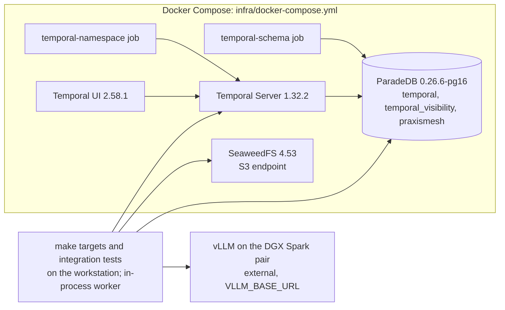

# RFC: Phase 0 local infrastructure

> **Amended by the decision log (2026-11-11, Phase 0 gate fixes).** `make up` now applies a changed `TEMPORAL_RETENTION` (step 4 below said it would not); `infra/.env` has a strict syntax and Make no longer reads it; `make status` fails when a service is unhealthy; the Compose project name is configurable. The as-built behavior is in `docs/architecture/overview.md`.

## Background

Every later phase runs on a local platform stack: Temporal for durable execution, the application database, object storage and model endpoints. Phase 0 builds that stack so it starts with one command, keeps its state across restarts and proves each part works. It contains no product logic.

Inputs:
- requirements in OpenSpec change `phase-0-local-infrastructure`;
- the database choice in ADR-0002, recorded as a plan decision in the decision log (2026-11-11);
- the model path from the Pre-0 spike (`docs/spikes/harness-vllm.md`).

Two terms used below:
- **§4.16, state ownership:** Temporal owns its execution history and its databases are private to it. The application keeps its own records in a separate database and never reads Temporal's tables.
- **The DGX Spark pair:** two NVIDIA DGX Spark machines that together serve one model through vLLM, at one base URL (for example `http://<spark-host>:8000`), under the served name `spark`.

## Plan

### Topology

| Service | Image (pinned by tag; digest recorded at implementation) | Host port (127.0.0.1 only) | Health check |
|---|---|---|---|
| `db` | `paradedb/paradedb:0.26.6-pg16` | 5432 | script over TCP: `pg_isready -h 127.0.0.1`, then `psql -h 127.0.0.1` checking that `pg_search` exists in `praxismesh`, the last thing init creates, so it passes only once init has finished and the server accepts network connections (F4) |
| `temporal-schema` | `temporalio/admin-tools:1.32.2` | none (one-shot) | exits 0 |
| `temporal` | `temporalio/server:1.32.2` | 7233 | `temporal operator cluster health`. If the server image lacks the `temporal` CLI (verify at implementation), use a gRPC health probe instead |
| `temporal-namespace` | `temporalio/admin-tools:1.32.2` | none (one-shot) | exits 0 |
| `temporal-ui` | `temporalio/ui:2.58.1` | 8080 | HTTP 200 |
| `s3` | `chrislusf/seaweedfs:4.53` (`weed server -s3`) | 8333 | HTTP on the S3 port |

Named volumes: `pgdata` (database) and `seaweeddata` (objects).

Not in Phase 0: a Compose vLLM service. The model runs on the Sparks, launched from the owner's model registry, a configuration repository outside this project (`geosp/mixvllm`). The launch flags Phase 0 task 2 asks for are recorded in `docs/spikes/harness-vllm.md` (Environment). A `vllm-local` profile is deferred until a GPU machine runs the stack; this is recorded as a Phase 0 deviation (F7).

### Startup order and idempotency (F1, F4)

1. **`db`** starts. On a **fresh volume only**, `infra/db/init.sh` runs as the superuser, with `set -e` and `psql -v ON_ERROR_STOP=1`. It:
   - creates roles `temporal` and `praxismesh` with passwords from `infra/.env`;
   - creates databases `temporal`, `temporal_visibility` (owner `temporal`) and `praxismesh` (owner `praxismesh`);
   - runs `REVOKE CONNECT ON DATABASE … FROM PUBLIC` on all three and grants `CONNECT` only to the owning role (F15);
   - runs `CREATE EXTENSION IF NOT EXISTS pg_search` in `praxismesh` only, as the superuser (F2). Whether the image's own setup also adds extensions to its template database (and so to Temporal's databases) is checked at implementation; Temporal needs none and is unaffected either way.

   If init fails, the health check never passes and `make up` reports `db` unhealthy. Init does not re-run on an existing volume, so a half-failed init or a changed password needs `make reset`. The README and the error message say so.
2. **`temporal-schema`** waits for a healthy `db`, then runs `temporal-sql-tool --plugin postgres12` `setup-schema -v 0.0` and `update-schema` for both Temporal databases. Both commands are safe to repeat, which implementation verifies by running `make up` twice.
3. **`temporal`** starts after `temporal-schema` completes successfully.
4. **`temporal-namespace`** waits for a healthy `temporal`. It creates namespace `TEMPORAL_NAMESPACE` (default `default`) with retention `TEMPORAL_RETENTION` (default `72h`; plan §4.13). If the namespace already exists, it succeeds without changes. It exits only once `temporal operator namespace describe` succeeds, so the namespace is usable. A changed `TEMPORAL_RETENTION` is not applied to an existing namespace; the README documents `temporal operator namespace update` for that (N7).
5. **`temporal-ui`** and **`s3`** start in parallel.

`make up` runs `docker compose up -d --wait --wait-timeout 180`. `--wait` treats one-shot jobs that exited 0 as done; if it doesn't (verify at implementation), `make up` waits for the long-running services only, then checks the jobs' exit codes. **Requirement: `make up` succeeds when run twice in a row.**

### Data boundaries

- **One ParadeDB server, three databases** (ADR-0002). Each role can connect only to its own databases.
- **Application schema:** Alembic in `common/persistence/migrations/`, per plan §6 (F10), applied with `make migrate` as role `praxismesh`. The baseline revision is empty. A second revision only **checks** that `pg_search` is installed, because creating it needs the superuser (done by init). Downgrading it is a no-op.
- **Objects:** SeaweedFS S3 with an access key and secret from `infra/.env`. Tests create a uniquely named bucket per run and remove it afterwards (F22). GCS and Ceph RGW settings are documented in the README, not run.
- **Models:** see Configuration.

### Configuration (F7, F12, F18)

The template is **`infra/.env.example`**, where plan §6 puts it (N2). The developer copies it to `infra/.env` (git-ignored). The Makefile passes it with `docker compose --env-file infra/.env -f infra/docker-compose.yml`, and `make smoke` and `make restart-check` export the same file into the test environment (N5). `infra/.env.example` lists every variable with placeholders:

- database: `POSTGRES_PASSWORD`, `TEMPORAL_DB_PASSWORD`, `APP_DB_PASSWORD`, `DB_PORT`;
- Temporal: `TEMPORAL_PORT`, `TEMPORAL_UI_PORT`, `TEMPORAL_NAMESPACE`, `TEMPORAL_RETENTION`;
- S3: `S3_PORT`, `S3_ACCESS_KEY`, `S3_SECRET_KEY`;
- model: `VLLM_BASE_URL` (empty by default), `VLLM_MODEL` (served name, default `spark`; it must not contain a `/`), `VLLM_API_KEY` (empty for the Sparks).

Both API styles use the same base URL: Anthropic Messages at `/v1/messages`, OpenAI chat at `/v1/chat/completions`.

CI copies `infra/.env.example` to `infra/.env`. The placeholder passwords are local to the runner and are not secrets. `VLLM_BASE_URL` stays empty there.

### Commands

`make up`, `make down` (keeps volumes), `make reset` (removes volumes), `make status` (lists each service's health and names any that are unhealthy, plus whether the model endpoint answers `/v1/models`; N8), `make migrate`, `make smoke` (integration tests), `make restart-check` (the automated restart sequence below), `make logs`.

`make up` first checks that Docker is running, that `infra/.env` exists, and that every required variable is set. It names whatever is missing (F6, F25).

### Code and tests (F8, F11, F19)

- **Dependencies:**
  - runtime, in `[project] dependencies`: `temporalio` (1.36, MIT), `alembic` (1.20, MIT), `sqlalchemy[asyncio]` (2.1, MIT) with the `asyncpg` driver (0.32, Apache-2.0), `boto3` (Apache-2.0), `httpx` (BSD-3-Clause). Not `psycopg` 3: it is LGPL-3.0, which CI's license allow-list does not include (N1). Alembic uses its async environment template;
  - dev: `boto3-stubs[s3]` for strict mypy;
  - all locked in `uv.lock`.
- **Integration tests** in `tests/integration/` (plan §6 lists integration as a suite), marked `integration`. The default `pytest` run excludes them (`addopts = "-ra -m 'not integration'"`, keeping `-ra`), so CI's unit `tests` job is unchanged. `make smoke` runs `pytest -m integration`.
- **Hello Workflow:** the test starts an **in-process Temporal worker** on a unique task queue per run (`phase0-smoke-<run id>`). It runs a `HelloWorkflow` that calls one `say_hello` Activity, and uses a unique Workflow ID per run. Phase 0 has no worker container. Visibility checks poll for up to 10 seconds, since visibility lags (N7). The Workflow also gets a **replay test** in `tests/test_hello_replay.py`, a unit test against a history file committed under `tests/fixtures/` (recorded once from the stack at implementation), so it needs no server (plan §8; N6). The Workflow has no timers, so no time-skipping test applies.

### Automated restart check (F3)

`make restart-check`, run by the CI `stack` job:
1. `up` and `migrate`;
2. seed: run the hello Workflow and put an object;
3. `down`, then `up`;
4. `migrate`, which must make no changes and keep the revision;
5. assert that the Workflow is still listed by the visibility API and the object reads back the same;
6. clean up.

### CI (F24)

A new `stack` job runs `make up`, `make migrate`, `make smoke` and `make restart-check`, with model tests skipped because `VLLM_BASE_URL` is empty.
- **Adding it to `ci-ok`** means two edits: add `stack` to `REQUIRED_JOBS` in `.github/scripts/ci_gate.py`, and to `ci-ok`'s `needs:` in `ci.yml`.
- **Cost:** a few minutes per PR, plus anonymous Docker Hub pulls, which are rate limited per runner IP. If pulls become flaky, the job still always runs, but its steps skip when a PR touches none of `infra/`, `common/persistence/`, `tests/integration/` (a skipped *job* would fail `ci-ok`; N4).
- **Updates:** Dependabot gets a `docker-compose` ecosystem entry for the image tags (F14).

## Traceability (F9)

| Plan requirement (phase-0.md) | OpenSpec requirement | Acceptance test |
|---|---|---|
| Compose: Temporal ≥ 1.28, PostgreSQL, UI, SeaweedFS S3, separate app DB | local-stack: One-command start and stop; app-database: Separate application database | `make up` twice in a row; `test_role_isolation` |
| vLLM configured, served name without `/` | model-endpoints: External model endpoint by configuration | `test_model_listed` (`VLLM_MODEL` appears in `/v1/models`); demo step 3 |
| `make up/down`, `.env.example`, health checks, ports, volumes, no secrets | local-stack: Health checks; Configuration without committed secrets; Clear diagnostics | `make status`; `test_env_check`; CI gitleaks |
| Hello Workflow smoke test; `curl` tests for both vLLM endpoints | local-stack: Temporal smoke test; model-endpoints: Both API styles answer, Endpoint unreachable | `test_hello_workflow`; `test_hello_replay` (unit); `test_messages_endpoint`, `test_chat_endpoint`; `test_unreachable_endpoint_fails` |
| BlobStore S3 put/get/delete; GCS and Ceph documented | blob-store: S3 round trip; Optional backends documented | `test_s3_round_trip`; README section |
| Migration baseline; clean volume and after restart | app-database: Migration baseline | `make restart-check` |
| Accept: state survives restart | local-stack: Persistent state | `make restart-check` |
| ADR-0002 confirmation (`pg_search`) | app-database: ParadeDB search extension available | `test_pg_search_installed` |

## Alternatives

- **`temporal server start-dev`** (single binary, SQLite): not the PostgreSQL persistence the plan targets. Rejected for the stack.
- **`temporalio/auto-setup`:** it would also create the namespace, but its newest tag is 1.29. Rejected in favor of server plus admin-tools jobs.
- **A separate plain PostgreSQL for Temporal:** rejected by ADR-0002, and kept as the fallback below.
- **MinIO for S3:** the plan replaced it with SeaweedFS.

## Risks

- **Temporal on ParadeDB is untested upstream.** Rethink trigger (§7.1): the schema job or the hello Workflow fails on this image. Fallback: a plain `postgres:16` service for Temporal's databases.
- **Memory:** the stack must stay under **6 GB** combined on the workstation (about 15 GB visible). `docker stats` is recorded in `docs/demos/phase-0.md`. Rethink trigger: over 6 GB at idle.
- **Model endpoint outside Compose (F5).** If `VLLM_BASE_URL` is **unset or empty**, model tests are skipped with the reason. If it is **set but unreachable**, they **fail**, naming the endpoint. Phase 0 closes only with a recorded run in which the model tests passed against the Sparks.
- **Image pinning:** digests are recorded at implementation; Dependabot proposes updates.

## Testing and demo

Automated: the tests in the traceability table, through `make smoke` and `make restart-check`. They run locally, and in CI without the model tests.

Demo (`docs/demos/phase-0.md`):
1. `make up` from a clean checkout, then `make status` showing every service healthy. Run `make up` a second time; it succeeds.
2. `make smoke`, then show the hello Workflow completed in the Temporal UI.
3. Send a real prompt to each vLLM endpoint (`/v1/messages`, `/v1/chat/completions`) and show the replies.
4. Upload an object; `make down` then `make up`; show the Workflow history and the object are still there; download and delete it.
5. **Failure cases:**
   - with `infra/.env` missing, `make up` names the missing file;
   - stop `db` with `docker compose stop db`, then `make status` names `db` as unhealthy and `make smoke` fails naming the database as unreachable;
   - with `VLLM_BASE_URL` set to an unreachable address, the model tests fail naming it.
6. Record `docker stats`; clean up with `make reset`.

## Future work

- A `vllm-local` Compose profile, once a GPU machine runs the stack.
- Kubernetes deployment (Phase 7); mTLS and encryption (Phase 9).
- A production split of Temporal and the application onto separate database servers (ADR-0002).
- The PraxisMesh documentation skill (before Phase 3A).
