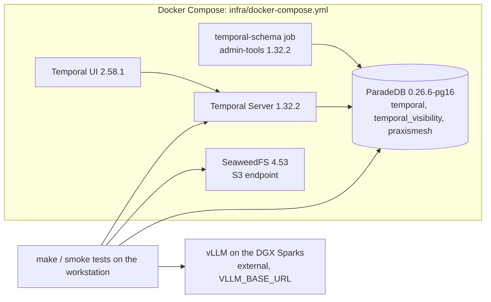

# RFC: Phase 0 local infrastructure

## Background

Every later phase runs on a local platform stack: Temporal for durable execution, the application database, object storage and model endpoints. Phase 0 builds that stack so it starts with one command, keeps its state across restarts and proves each part works. It contains no product logic. Requirements are in OpenSpec change `phase-0-local-infrastructure`; the database choice is ADR-0002; the model path is the Pre-0 spike (`docs/spikes/harness-vllm.md`).

## Plan

### Topology

| Service | Image (pinned by tag and digest) | Host port, bound to 127.0.0.1 | Health check |
|---|---|---|---|
| `db` | `paradedb/paradedb:0.26.6-pg16` | 5432 | `pg_isready` |
| `temporal-schema` | `temporalio/admin-tools:1.32.2` | none (one-shot) | exits 0 |
| `temporal` | `temporalio/server:1.32.2` | 7233 | `temporal operator cluster health` |
| `temporal-ui` | `temporalio/ui:2.58.1` | 8080 | HTTP 200 |
| `s3` | SeaweedFS 4.53 (`server -s3`) | 8333 | HTTP on the S3 port |
| `vllm` (profile `vllm-local`, off) | vLLM image from the model registry | 8000 | `/health` |

The all-in-one `temporalio/auto-setup` image is not used: its latest tag is 1.29, behind the 1.32 release.

### Data boundaries

- **One ParadeDB server, three databases** (ADR-0002): `temporal` and `temporal_visibility` (owned by role `temporal`), and `praxismesh` (owned by role `praxismesh`). An init script creates the databases and roles on first start. Each role can connect only to its own databases, so the application cannot touch Temporal's (§4.16).
- **Temporal schema:** the `temporal-schema` job runs `temporal-sql-tool --plugin postgres12` setup and update for both Temporal databases. The server starts only after it succeeds. Visibility uses PostgreSQL advanced visibility (12 or later).
- **Application schema:** Alembic in `migrations/`, an empty baseline revision, then one revision creating `pg_search`. `make migrate` runs `alembic upgrade head` as role `praxismesh`.
- **Objects:** SeaweedFS S3 with an access key and secret from `.env`. The smoke test creates its own bucket. GCS and Ceph RGW settings are documented, not run.
- **Models:** `VLLM_BASE_URL` in `.env` points at the Spark server (served name `spark`, no `/`). The optional `vllm-local` profile is for a GPU machine only.

### Commands and configuration

- `.env.example` holds placeholders for ports, database passwords, S3 keys and `VLLM_BASE_URL`. `.env` is git-ignored.
- `make up` checks Docker and `.env` (and names any missing variable), then runs `docker compose up -d --wait`. On a timeout it exits non-zero, naming the unhealthy service.
- `make down` stops the stack and keeps volumes. `make reset` also removes volumes. `make migrate`, `make smoke` and `make logs` do what their names say.

### Dependencies added to the project

`temporalio` (1.36), `alembic` (1.20), `psycopg` 3, `boto3`, `httpx`, pinned in `uv.lock`, plus a `smoke` pytest marker. Unit tests stay as they are; smoke tests run only with `make smoke` or in the CI `stack` job.

## Alternatives

- **`temporal server start-dev`** (single binary, SQLite): fastest to start, but not the PostgreSQL persistence the plan targets. Rejected for the stack; fine for quick local experiments.
- **`temporalio/auto-setup`:** convenient, but stuck at 1.29. Rejected in favor of server plus admin-tools.
- **A separate plain PostgreSQL for Temporal:** rejected by ADR-0002 for Compose.
- **MinIO for S3:** the plan replaced it with SeaweedFS.

## Risks

- **Temporal on ParadeDB is untested upstream.** Temporal tests PostgreSQL 16, not ParadeDB. Rethink trigger: the schema job or smoke test fails on this image. Fallback: a plain `postgres:16` service for Temporal (ADR-0002 consequence).
- **Memory on the workstation** (about 15 GB visible). Temporal, ParadeDB and SeaweedFS should need a few GB; Phase 0 records actual use.
- **The model endpoint is outside Compose.** If the Sparks are down, model smoke tests are skipped with the reason, never reported as passed.
- **Image pinning:** digests are recorded at implementation, and Dependabot proposes updates.

## Testing and demo

- **Automated acceptance** (`make smoke`, and the CI `stack` job with model tests skipped):
  - the hello Workflow completes and is visible through the visibility API;
  - S3 put, get and delete;
  - `make migrate` from a clean volume and again after a restart;
  - `pg_search` installed;
  - the application role is refused on Temporal's databases;
  - both vLLM endpoints answer (local runs only).
- **Demo** (`docs/demos/phase-0.md`):
  1. `make up` from a clean checkout, then show every service healthy.
  2. Run the hello Workflow and show it completed in the Temporal UI.
  3. Send a real prompt to each vLLM endpoint and show the replies.
  4. Upload an object, `make down` and `make up`, then show the Workflow history and the object are still there; download and delete it.
  5. **Failure case:** run `make up` with `.env` missing, and again with the database stopped, and show the named diagnostic each time.
  6. Clean up with `make reset`.

## Future work

- Kubernetes deployment (Phase 7).
- mTLS and encryption (Phase 9).
- A production split of Temporal and the application onto separate database servers (ADR-0002 leaves this open).
- The PraxisMesh documentation skill, deferred to before Phase 3A as the plan allows.
