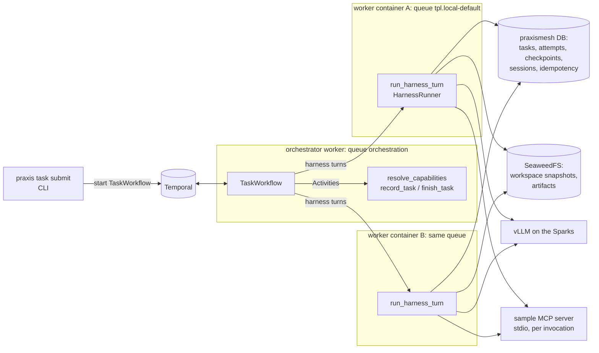
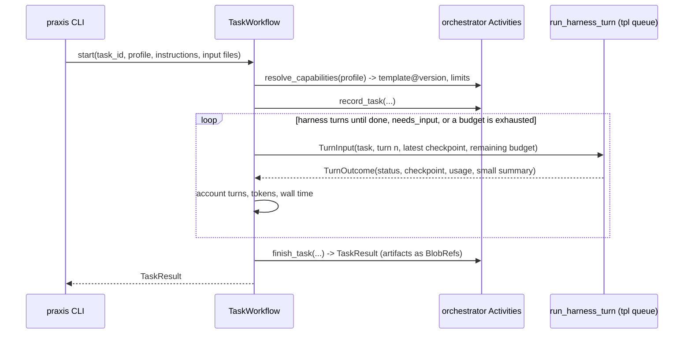

# RFC: Phase 1 harness-in-Activity, single agent

## Background

Phase 0 built the local stack: Temporal, ParadeDB, SeaweedFS and an external vLLM endpoint. Phase 1 adds the first product code. One agent, on the local model, does useful work as a durable Temporal task, and survives the loss of its worker mid-task (issue #44; plan Phase 1, §4.1, §4.2, §4.10, §4.13).

Owner decisions (decision log, 2026-11-12):
- both harness runners sit behind one `HarnessRunner` interface, with **`openai_agents` as the default** while the Claude Agent SDK's licensing with local models is open (§2);
- the benchmark regression limit is **at most 1 task lost out of 10**;
- under Compose, "pod loss" means **stopping one worker container while a second takes over**.

APIs checked on 2026-11-12 against the installed packages (plan §2: verify live APIs):

| Package | Version | What this design relies on |
|---|---|---|
| `openai-agents` | 0.24.0 (MIT) | `Runner.run(..., max_turns, session=)`; the `Session` protocol (`get_items`, `add_items`, `pop_item`, `clear_session`) and `extensions.memory.SQLAlchemySession`; `MCPServerStdio` with `tool_filter`; `RunHooks`; `agents.testing.ScriptedModel` for deterministic runs |
| `claude-agent-sdk` | 0.2.180 (MIT; bundles the Claude Code CLI) | `ClaudeAgentOptions(resume, session_id, session_store, mcp_servers, strict_mcp_config, setting_sources, skills, allowed_tools, disallowed_tools, max_turns, effort, cwd, env)`; the `SessionStore` protocol (`append`, `load`, `list_sessions`, `list_subkeys`, `delete`, `list_session_summaries`) |
| `temporalio` | 1.36.0 (MIT) | Activities with heartbeats and heartbeat details; `WorkflowEnvironment` (time-skipping) and `Replayer`; `contrib.opentelemetry.TracingInterceptor`; `contrib.pydantic` data converter |
| `opentelemetry-sdk` | 1.45.2 (Apache-2.0) | spans and OTLP export |

## Plan

### Terms

| Term | Meaning |
|---|---|
| **Inner turn** | One model call inside a harness invocation (the SDK's `max_turns`). Limited per Activity by the template's `inner_max_turns`. |
| **Harness turn** | One `run_harness_turn` Activity: a bounded harness invocation of up to `inner_max_turns` inner turns. Limited per task by the profile's `max_turns`. |
| **Attempt** | One execution of a harness turn. Temporal retries create further attempts for infrastructure failures (a lost worker, a timeout). Attempts never count as harness turns. |
| **Checkpoint** | A durable pair recorded in PostgreSQL: the session position and the workspace snapshot `BlobRef`. It is written after each inner turn that changed something, and is **acknowledged** once its row is committed and its ID is sent in a heartbeat. |
| **Budget** | Per-task limits on harness turns, tokens and wall time, from the profile (capped by the template). The Workflow stops the task when one is exhausted. |

### Components and repository layout (plan §6)

| Path | Contents |
|---|---|
| `common/schemas/` | Pydantic models with `schema_version`: `AgentProfile`, `WorkerTemplate`, `McpServer`, `BlobRef`, `TaskResult`, `TurnInput`, `TurnOutcome`, `ExecutionAttempt` (§5 fields; the parts Phase 1 needs) |
| `common/blob_store/` | the `BlobStore` protocol, typed errors, the S3 adapter, and contract tests |
| `common/persistence/` | migration `0003` and the repositories for the new tables |
| `common/observability/` | JSON logging with context IDs, OpenTelemetry setup, Prometheus metrics |
| `registry/` | `profiles/*.yaml`, `templates/*.yaml`, `mcp/*.yaml`, `skills/<bundle>/`, and loaders that validate and version them |
| `orchestrator/` | `TaskWorkflow`, its Activities, and the `praxis` CLI |
| `harness_activity/` | `run_harness_turn`, the `HarnessRunner` interface, the `OpenAIAgentsRunner` and `ClaudeSdkRunner`, the session stores, workspace snapshots, and the command tool |
| `sample_mcp/` | the sample MCP server (stdio) |
| `comms_mcp/` | a stub; messaging arrives in Phase 2 |
| `workers/` | the generic worker entry point and `Dockerfile` |
| `tests/benchmarks/agent_tasks/` | the benchmark suite; results in `docs/benchmarks/` |

### Capability model (§4.10, §5)

- **`WorkerTemplate`:** `name`, `version`, `harness`, `model`, `base_url_env`, `api_style`, `allowed_model_overrides[]`, `mcp_servers[]` (catalog names), `skills_bundle`, `cli_tools[]`, `inner_max_turns`, `turn_timeout`, `heartbeat_timeout`, `concurrency_per_pod`, `secret_refs[]`. It derives `capabilities[]`. The resource and scaling fields are accepted and stored, but unused until Phase 7.
- **`AgentProfile`:** `name`, `tier`, `harness`, `model_override?`, `allowed_templates[]?`, `max_turns`, `max_tokens`, `max_wall_time`. It has **no MCP or skills fields**. The schema forbids extra fields, so a profile that names MCP servers or skills fails to load.
- **`McpServer`:** `name`, `transport` (Phase 1 runs `stdio` only), `command`, `args`, `env` (non-secret), `tools_allowed[]`, capability tags.
- **Loaders:** read the YAML in `registry/` and validate it. Each template is identified by `name@version`, plus a content hash so a changed file without a version bump is detected. A task records the exact template version and hash it ran with.
- **Requests carry only a profile name, the instructions and optional input files.** The harness configuration (MCP, skills, tools, model) is built **only from the template**. A request that names a skill, an MCP server or a tool is rejected before the Workflow starts, and so is a profile that tries to (negative capability tests).

### `BlobStore` contract (§4.13, §5)

- **Interface:** `async put(data | stream, *, content_type, retention) -> BlobRef`, `get(ref) -> bytes`, `stream(ref) -> AsyncIterator[bytes]`, `stat(ref) -> BlobRef`, `delete(ref)`.
- **Keys:** content-addressed, `sha256/<hex>`. A `put` of existing content is a no-op that returns the same `BlobRef`, which makes it idempotent under retry.
- **`BlobRef`:** an opaque `id`, `key`, `checksum` (sha256), `content_type`, `bytes`, `retention_class` and `created_at`. It never carries credentials.
- **Typed errors:** `BlobNotFound`, `BlobCorrupt` (checksum mismatch on read), `BlobUnauthorized` and `BlobUnavailable` (retryable). Every adapter maps its own errors onto these.
- **S3 adapter:** boto3 run in a thread (`asyncio.to_thread`), path-style addressing, bucket from configuration. It is verified against SeaweedFS; Ceph and GCS stay in Phase 3A.
- **Metadata:** every `put` also records a row in `blob_objects`, with its retention class.
- **Contract tests:** one suite that any adapter must pass, run against SeaweedFS in the `stack` job and against an in-memory fake in unit tests.

### Retention classes (§4.13)

Every blob and every stored record gets a `retention_class` from its first write: `ephemeral` (scratch, for example intermediate snapshots), `task` (task state and checkpoints) or `audit` (attempts, idempotency records, results). Phase 1 only records the class and its default lifetime in `common/persistence/retention.py`. Deletion and garbage collection arrive in Phase 3A.

### Application database: migration `0003` (§5)

| Table | Purpose | Key columns |
|---|---|---|
| `tasks` | one row per task | `task_id`, `workflow_id`, `profile`, `template`, `template_version`, `template_hash`, `status`, `result_ref`, timestamps, `retention_class` |
| `task_attempts` | one row per harness-turn attempt (`ExecutionAttempt`) | `task_id`, `turn`, `attempt`, `worker_identity`, `outcome`, `failure_category`, `tokens_in`, `tokens_out`, `tool_calls`, started and ended, `retention_class` |
| `checkpoints` | acknowledged session and workspace positions | `checkpoint_id`, `task_id`, `turn`, `seq`, `session_id`, `session_position`, `workspace_ref`, `created_at`, `retention_class` |
| `idempotency_keys` | side-effect deduplication | `key` (primary key), `task_id`, `result_ref` or small `result`, `created_at`, `retention_class` |
| `blob_objects` | blob metadata | `key`, `checksum`, `bytes`, `content_type`, `retention_class`, `created_at` |
| `agent_sessions`, `agent_messages` | the OpenAI Agents session store, created by our migration with the table layout `SQLAlchemySession` expects (never `create_tables=True` at runtime) | as the SDK defines them |
| `claude_session_entries` | the Claude `SessionStore` adapter | `session_key`, `subkey`, `seq`, `entry` (JSONB), `created_at` |

`TaskWorkflow` never reads these tables as hidden replay state. All database access happens in Activities (§5).

### `TaskWorkflow` (orchestration queue)

- **Workflow ID:** the `task_id`. Starting the same task ID twice is rejected by Temporal, which makes submission idempotent.
- **Each harness turn** is an Activity on queue `tpl.{template}`, with `start_to_close = turn_timeout`, `heartbeat_timeout` from the template, and a retry policy for infrastructure failures only:
  - **Non-retryable:** `CapabilityError`, `BudgetExceeded`, `InvalidTaskInput`.
  - **Attempts:** at most 5, with backoff.
- **Turn outcomes:** a harness turn returns `done`, `continue` (the inner-turn limit was reached and work remains) or `needs_input`. The Workflow starts another harness turn only on `continue` and while budget remains.
- **Exhausted budget:** the task ends `failed`, with the reason, and the last checkpoint is kept.
- **Small history:** inputs and outputs carry IDs and `BlobRef`s, never transcripts or file contents.
- **Tests:** deterministic replay tests against recorded histories, and time-skipping tests with mocked Activities (retry, timeout, budget exhaustion, `needs_input`) (§8).

### `run_harness_turn` (§4.1)

1. **Restore.** Read the newest acknowledged checkpoint for the task. That is the `TurnInput`'s checkpoint, or a newer one recorded by an earlier attempt of the same turn, read from the heartbeat details or from `checkpoints`. Download the workspace snapshot into a fresh directory under the worker's scratch volume; turn 1 starts from the task's input files. The session is restored from its store by `session_id`.
2. **Configure only from the template.** Build the model client, the MCP servers (spawned as stdio subprocesses, with `tool_filter` limited to `tools_allowed`), the skills bundle (mounted read-only under `.skills/` in the workspace, and listed in the instructions) and the built-in tools: `read_file`, `write_file`, `list_files`, and `run_command` if `cli_tools` is non-empty. The Claude runner additionally sets:
   - `strict_mcp_config=True`;
   - `setting_sources=[]`, so no user or project settings or skills are discovered;
   - `skills` limited to the bundle;
   - `allowed_tools` from the template.
3. **Run** at most `inner_max_turns` inner turns.
   - **Heartbeats:** every few seconds, with bounded details: `checkpoint_id`, inner turn, tool-call count and tokens so far.
   - **Hooks:** count tool calls and tokens.
   - **Checkpoints:** after each inner turn that changed the workspace or the session:
     - pack the workspace (tar plus gzip, excluding `.skills/`) and `put` it as a `task` blob;
     - insert a `checkpoints` row;
     - send its ID in the next heartbeat.

     Snapshots are content-addressed, so an unchanged workspace adds nothing.
4. **Finish.** Upload declared output files as `audit` blobs, write the `task_attempts` row, and return a `TurnOutcome` with its usage and a summary of at most 2 KB.

**Sessions.**
- **`openai_agents`:** an `SQLAlchemySession` on the `praxismesh` database (asyncpg), keyed by `task_id`. Every item is committed as the run adds it, so the conversation survives the worker by construction. The checkpoint records the session's item count, and on restore any items after the checkpoint's count are discarded with `pop_item`, so session and workspace stay consistent.
- **`claude_sdk`:** a `SessionStore` adapter on `claude_session_entries`, resumed with `resume=<session_id>`. Whether the CLI resumes a session written on another machine from that store alone is verified in the first implementation PR. If it cannot, the fallback is the plan's (§7.1 risk table): restart the harness turn from the last checkpoint's workspace plus a summary of the transcript, recorded as a deviation.

**Recovery on another worker.** Stopping a worker container stops its heartbeats. After `heartbeat_timeout` (30 s by default), Temporal times out the attempt and schedules the next one on `tpl.local-default`, where the second worker picks it up and restores from the last acknowledged checkpoint (step 1). Worker affinity (`tpl.{template}.{pod}`) is not used in Phase 1. It is an optimisation only (§4.2).

### Side effects and idempotency (§4.2)

- **Side-effecting tools take an idempotency key.** Every tool that changes something outside the workspace receives one, built from `task_id`, the tool name and the canonical JSON of its arguments. The key does not include the model's tool-call ID, because a model that re-issues a call after a crash would produce a new one.
- **`idempotency_keys` is the gate.** A tool's effect and its key row commit in one transaction, or the effect is checked against the row first. A repeat returns the recorded result.
- **The sample MCP tool demonstrates this.** `record_order(sku, qty)` writes to a `sample_orders` table, and the test kills the worker between the effect and the next checkpoint.
- **Known limit:** a model that retries with different arguments is a different call. The threat model records this.

### The sample skill and MCP server

- **`sample_mcp` (stdio):** `lookup_price(sku)`, `lookup_stock(sku)`, which are read-only, and `record_order(sku, qty)`, which is side-effecting and idempotent.
- **Skill bundle `registry/skills/order-desk/`:** `SKILL.md` describes how to write an order summary file (format, rounding, and recording each order once).
- **Template `local-default@1`:** `openai_agents`, model `spark`, MCP `sample-shop`, skills `order-desk`, `cli_tools: [python3, wc, git, sh]`, `inner_max_turns: 8`.
- **Profile `default`:** `max_turns: 6`.

### Command tool and containment (Phase 1 level)

`run_command` runs only in the task workspace, inside the worker container:
- its environment is minimal (`PATH`, `HOME` set to the workspace, `LANG`), so no credentials, template secrets or `infra/.env` values reach it;
- it has a timeout and caps its output;
- it is offered only when the template lists `cli_tools`, and the first word of the command must be one of them.

This is **not** a sandbox for untrusted code: network egress is not restricted, and a pipe can call any binary in the image. That is the Phase 5 ADR (§2). `docs/security/threat-model.md` records it as an accepted Phase 1 risk.

### Workers and Compose

- **`workers/Dockerfile`:** a Python 3.11 image with the project installed through uv.
  - **Claude harness:** installed **at image build time on the installer's machine**, behind the `INSTALL_CLAUDE_HARNESS=1` build argument. No image is published (§2).
- **Compose profile `workers`** in `infra/docker-compose.yml`:
  - `orchestrator` polls `orchestration`;
  - `worker-a` and `worker-b` poll `tpl.local-default`;
  - each gets its own scratch volume, plus the database, S3 and model settings from `infra/.env`.
- **New targets:**
  - `make workers-up` and `make workers-down`;
  - `make task PROMPT=…` (wraps `praxis task submit`);
  - `make benchmark`.
- **Without containers:** tests run workers in-process.

### Observability baseline

- **Logs:** JSON lines to stdout with `request_id`, `task_id`, `workflow_id`, `turn`, `attempt` and `worker`. They are set through `contextvars`, from Workflow and Activity info.
- **Traces:** OpenTelemetry with Temporal's `TracingInterceptor` on the client and the workers. One trace spans the CLI submission, the Workflow, each Activity and the harness's model and tool calls (child spans from hooks).
  - **Export:** OTLP when `OTEL_EXPORTER_OTLP_ENDPOINT` is set; otherwise none.
  - **Tests:** an in-memory exporter checks the parent-child chain.
- **Metrics:** `prometheus-client` on each worker's `/metrics` port: Activity duration, heartbeat lag, tokens, tool calls and tool errors, checkpoint size and time.
- **Compose profile `observability`:** Prometheus, plus Jaeger to view traces (both optional, pinned by digest).

### Agent benchmark suite (plan §8)

- **Tasks:** the 10 spike tasks move to `tests/benchmarks/agent_tasks/`, adapted to the sample MCP server, with their deterministic checks unchanged in substance.
- **Running:** `make benchmark` runs each task once through `TaskWorkflow` on the configured template. Results go to `docs/benchmarks/<date>-<template>.md`: pass/fail per task, harness turns, inner turns, tokens and wall time, plus the model, template version, harness version and prompt hash.
- **Baseline:** the first run on the Sparks with `local-default@1`.
- **Rule:** a later run that passes 2 or more fewer tasks than the baseline blocks phase closure.
- **Not in PR CI:** it needs the real model (§8). It runs on request, and its latest result is linked from the phase evidence.

### Threat model, first version

`docs/security/threat-model.md` covers:
- **Assets:** workspace contents, sessions, the database, object storage, model endpoint access, template secrets.
- **Trust boundaries:** CLI to Temporal; Workflow to worker; worker to model, MCP and the command tool; worker to the database and S3.
- **Actors:** a hostile prompt, hostile file content, a compromised worker, an over-privileged profile.
- **Controls:**
  - template-only capabilities;
  - an extra-forbidding profile schema;
  - the request schema;
  - the MCP tool filter;
  - the command allow-list and the credential-free environment;
  - idempotency keys;
  - no secrets in Temporal history.

  Each control maps to a test.
- **Accepted Phase 1 risks:** no network egress control; no sandbox for untrusted code.

### Dependencies

New runtime dependencies, with their expected licenses. CI's license check confirms them in the first PR.

| Package | License |
|---|---|
| `openai-agents` | MIT |
| `pydantic` | MIT |
| `pyyaml` | MIT; becomes runtime |
| `opentelemetry-sdk` | Apache-2.0 |
| `opentelemetry-exporter-otlp` | Apache-2.0 |
| `prometheus-client` | Apache-2.0 |
| `mcp` | MIT |

`claude-agent-sdk` (MIT, bundling the Claude Code CLI under Anthropic's terms) is an **optional** extra, `praxismesh[claude]`. It is installed only when the Claude runner is wanted, and is never part of a published artifact.

### Implementation PRs

1. **Foundations:**
   - schemas and loaders, with negative capability tests;
   - `BlobStore` and its contract tests;
   - migration `0003` and retention classes;
   - observability setup;
   - the CLI skeleton.
2. **Harness:**
   - `HarnessRunner` with the `OpenAIAgentsRunner` (scripted model in CI) and the `ClaudeSdkRunner`;
   - `run_harness_turn` without mid-turn recovery;
   - `TaskWorkflow` with replay and time-skipping tests;
   - the sample MCP server and skill;
   - the `workers` Compose profile.
3. **Durability:**
   - checkpoints, session restore and workspace snapshots;
   - recovery on the second worker (`make recovery-check`);
   - idempotency, and the kill-between-effect-and-checkpoint test;
   - the Claude session-store verification.
4. **Evidence:**
   - the benchmark suite and baseline;
   - the threat model;
   - the `observability` profile and the trace demo;
   - the demo record;
   - the as-built section.

## Traceability

| Plan requirement (phase-1.md) | OpenSpec capability | Acceptance test |
|---|---|---|
| Versioned profiles, templates, MCP catalog, loaders, generic worker | `agents/capability-model` | `test_loaders`, `test_profile_rejects_capability_fields`, `test_request_rejects_capability_fields` |
| Minimal `BlobStore`, S3 adapter, contract tests | `storage/blob-store` | `test_blob_contract` (fake and SeaweedFS) |
| Phase 1 migrations, retention class from the first write | `persistence/app-database` | `test_migration_0003`, `test_every_row_and_blob_has_retention` |
| Baseline observability | `observability/baseline` | `test_trace_parentage`, `test_log_context_ids`, `test_metrics_endpoint` |
| Agent benchmark suite | `quality/agent-benchmarks` | `make benchmark`, with the baseline recorded |
| Threat model, first version | `security/threat-model` | the controls-to-tests table in the document |
| `run_harness_turn`: template-configured model, MCP, skills, bounds, heartbeat, `TaskResult`, session ref | `execution/harness-turn` | `test_harness_turn_scripted`, `test_template_only_configuration`, `test_heartbeat_details` |
| Durable session and workspace snapshots; recovery on another worker | `execution/durability` | `make recovery-check`; `test_restore_discards_items_after_checkpoint` |
| `TaskWorkflow`: turn and budget accounting, retry semantics | `execution/task-workflow` | `test_task_workflow_*` (time-skipping), `test_task_workflow_replay` |
| Sample skill and MCP tool; negative capability test | `agents/capability-model` | `test_forbidden_skill_or_tool_rejected` |
| No duplicated side effects | `execution/durability` | `test_side_effect_not_repeated_after_crash` |

## Alternatives

- **`temporalio.contrib.openai_agents`** (the agent loop inside the Workflow, each model call an Activity): durability per step, built in. Rejected:
  - the Claude runner is a CLI subprocess and cannot run inside a Workflow, and one `HarnessRunner` interface needs both runners to run the same way;
  - the plan (§4.1) puts a bounded harness invocation in one Activity;
  - mid-turn checkpoints give the recovery the plan asks for.

  This stays the first option to revisit if mid-turn checkpointing proves fragile.
- **Checkpoint only at the end of a harness turn:** simpler, but a lost worker would lose up to `inner_max_turns` of edits, which fails the acceptance criterion "deleting a pod after workspace edits still restores".
- **Sessions only as blobs:** the SDKs' own stores (`SQLAlchemySession`, `SessionStore`) commit item by item. Blob-only storage would need its own consistency logic.
- **The SDK's sandbox agent for skills:** it brings a sandbox session model that the Claude runner does not share. Mounting the bundle read-only and listing it works the same way for both runners.
- **Claude as the default harness:** rejected by the owner while licensing is open.

## Risks

- **A Claude session may not restore on another worker from the store alone** (plan risk table). It is verified in PR 3; the fallback is defined above. `openai_agents`, the default, does not depend on it.
- **Mid-turn checkpoint consistency.** A crash between the workspace `put` and the `checkpoints` insert leaves an orphan blob, which is harmless and content-addressed. A crash after the insert but before the heartbeat is also covered, because restore reads `checkpoints` itself. A crash between a side effect and the next checkpoint is covered by idempotency keys.
- **The local model's reliability on multi-turn tasks.** Measured by the benchmark. The §7.1 trigger: below 7 of 10 on the baseline.
- **Token use:** the Claude runner used about 14 times the input tokens in the spike. It is not the default, and the benchmark records tokens.
- **Shell access without a sandbox:** accepted for Phase 1 and recorded in the threat model; Phase 5 closes it.
- **Workspace size:** snapshots are whole-workspace tarballs, so the benchmark records checkpoint size and time. The trigger: a checkpoint over 50 MB or over 2 s on the sample tasks.

## Testing and demo

- **Automated (PR CI, hosted runners, scripted models):**
  - unit tests: schemas and loaders, negative capability, `BlobStore` against the fake, idempotency, session restore, logs and traces;
  - `TaskWorkflow` replay and time-skipping tests;
  - integration in the `stack` job: `BlobStore` contract against SeaweedFS, migration `0003`, a scripted end-to-end task through the real workers, and `make recovery-check` with a scripted model.
- **Real model (on request, linked from the evidence):** the end-to-end sample task and `make benchmark` against the Sparks. Phase 1 cannot close on stubbed results alone (§8).
- **Demo** (`docs/demos/phase-1.md`), entry point `make workers-up`, then `make task`:
  1. The sample task uses the `order-desk` skill and the `sample-shop` MCP tool, and produces `order-summary.md` plus a validated `TaskResult`. Show the file, the `TaskResult` and the task in the Temporal UI.
  2. During a second task, wait for an acknowledged checkpoint (visible in the logs and `make task-status`), then stop the worker running it. Worker B resumes and finishes. Show the same `task_id` and Workflow ID before and after, the edits kept, and the conversation continuing.
  3. Retry: show that `record_order` ran once (`sample_orders` has one row per order) after the kill-between-effect-and-checkpoint case. Submit a request that names a skill or an MCP server and show the explicit rejection.
  4. Show one trace from submission to result in Jaeger.
  5. Clean up with `make workers-down` and `make reset`.

## Future work

- Live messaging and streaming, and `comms_mcp`: Phase 2.
- Ceph and GCS adapters, presigned access, retention enforcement and garbage collection, Claim Check: Phase 3A.
- Worker affinity queues: only if measurements call for them.
- A sandbox for untrusted code, egress control and published images: Phase 5 and the licensing decision.
- The PraxisMesh documentation skill: before Phase 3A.
