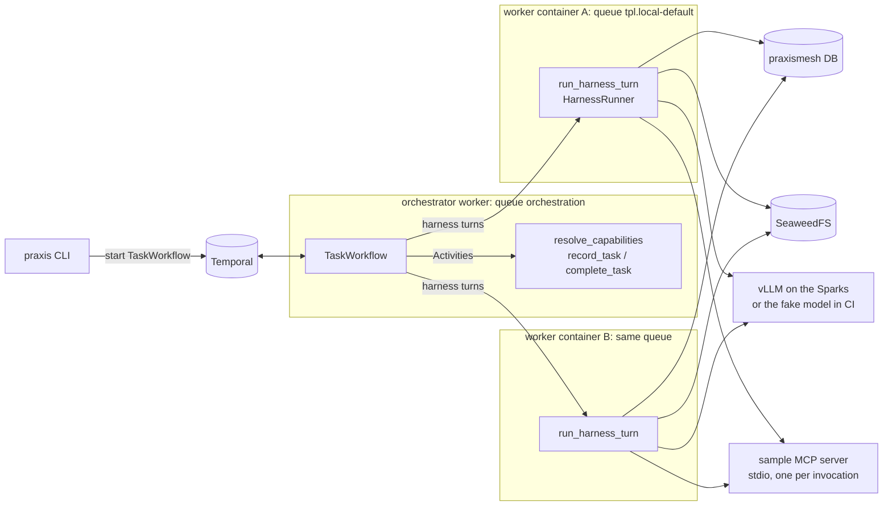
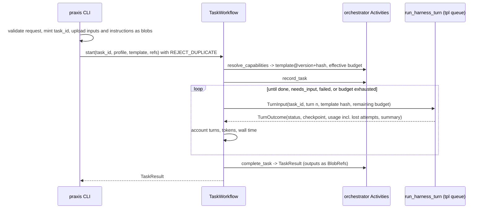

# RFC: Phase 1 harness-in-Activity, single agent

## Background

Phase 0 built the local stack: Temporal, ParadeDB, SeaweedFS, and an external vLLM endpoint. Phase 1 adds the first product code. One agent, on the local model, does useful work as a durable Temporal task and survives the loss of its worker mid-task. Tracking issue: #44.

Plan references:
- [PROJECT_PLAN.md](../../PROJECT_PLAN.md) and its document map;
- [the Phase 1 file](../plan/phases/phase-1.md), the [design decisions](../plan/design-decisions.md) §4.1, §4.2, §4.10 and §4.13, and the [schemas](../plan/schemas.md) §5.

The Pre-0 spike, [docs/spikes/harness-vllm.md](../spikes/harness-vllm.md), ran both harnesses against the local model. Its 10 tasks seed the benchmark suite.

Owner decisions (decision log, 2026-11-11):
- The harness sits behind one `HarnessRunner` interface. Phase 1 implements **only the `openai_agents` runner**. The Claude Agent SDK runner is **deferred to its own change**, to come after the owner decides its licensing with local models (plan §2). The owner first chose both runners with `openai_agents` as the default, then deferred the Claude runner after the design follow-up review.
- The benchmark regression limit is **at most 1 task lost out of 10**.
- Under Compose, "pod loss" means **stopping one worker container while a second one takes over**.

APIs checked on 2026-11-11 by reading the installed packages (plan §2: verify live APIs):

| Package | Version | What this design relies on |
|---|---|---|
| `openai-agents` | 0.24.0 (MIT) | `Runner.run(..., max_turns, session=, run_config=, hooks=)`, raising `MaxTurnsExceeded` at the limit   `Agent(tool_use_behavior={"stop_at_tool_names": [...]})`, which ends the run when a named tool is called. **Not `Agent(output_type=)`:** it sends a JSON-schema `response_format` with every request, and on the Sparks the model then never finishes (0 of 3 runs, checked 2026-11-11; with a `finish_task` tool, 3 of 3)   `MCPServerStdio(client_session_timeout_seconds=)`, default 5 s   `RunConfig(tracing_disabled, tool_not_found_behavior)`; the defaults are `False` and `"raise_error"`   `set_tracing_disabled()` and `set_trace_processors([])`: the first alone leaves the default backend processor registered   `RunHooks.on_llm_start/on_llm_end/on_tool_start/on_tool_end`   the `Session` protocol and `extensions.memory.SQLAlchemySession`   `MCPServerStdio` with `tool_filter` |
| `temporalio` | 1.36.0 (MIT) | `start_workflow(id_reuse_policy, id_conflict_policy)`; **the default reuse policy is `ALLOW_DUPLICATE`**   `activity.heartbeat()` returns `None`; a timeout or cancellation arrives as cancellation, with `activity.cancellation_details()`   heartbeat details, which the next attempt reads from `activity.info().heartbeat_details`   `WorkflowEnvironment` (time-skipping) and `Replayer`   `contrib.opentelemetry.TracingInterceptor`   `contrib.pydantic` |
| `opentelemetry-sdk`, `-exporter-otlp` | 1.45.2 (Apache-2.0) | Spans and OTLP export. Checked on PyPI only, not installed yet; PR 1 verifies the API in use |

### Terms

Section numbers such as §4.1 refer to the plan's sections, listed in the document map of [PROJECT_PLAN.md](../../PROJECT_PLAN.md). In the front matter, `tier: light` is the plan's lighter review process for Phases 0-2 (§7.0), `size` is a rough estimate, and `pre0_inputs` are the decisions made before Phase 0. "Phase closure" is the final gate of §8.

| Term | Meaning |
|---|---|
| **Template** (`WorkerTemplate`) | The unit of capability: model, endpoint, MCP servers, skills, tools and limits. Workers poll one template's queue, `tpl.{template}`. |
| **Profile** (`AgentProfile`) | Who the agent is, and the task-level limits. It grants no capabilities. |
| **Inner turn** | One model call inside a harness invocation. This is the SDK's `max_turns`, capped per Activity by the template's `inner_max_turns`. |
| **Harness turn** | One `run_harness_turn` Activity, which is one bounded harness invocation. Capped per task by the effective `max_turns`. |
| **Attempt** | One execution of a harness turn. Temporal retries after infrastructure failures create further attempts. They never count as harness turns. |
| **Checkpoint** | A committed `checkpoints` row recording a session position and a workspace snapshot `BlobRef`. It counts as **acknowledged** once its row is committed. |
| **Budget** | Per-task limits on harness turns, tokens and wall time: the smaller of the profile's value and the template's cap. |
| **`stack` job** | The CI job that runs the Compose stack and the integration tests (Phase 0). |
| **Tier** | The profile's capability level (§4.4). Phase 1 has one tier, `local`. |
| **`spark`** | The served model name on the Sparks' vLLM (Pre-0.1). Templates name it as `model`. |
| **`sample-shop`** | The catalog name of the `McpServer` entry that runs `sample_mcp`. |
| **`ExecutionAttempt`** | The schema of one `task_attempts` row. |
| **System prompt** | Owned by the template: a prompt file in `registry/`, included in the template hash and recorded as the prompt hash. |
| **`request_id`** | Minted by the CLI for each submission. A task has one, and logs carry it. |
| **`worker_identity`** | `<hostname>@<pid>/<template>`, which Temporal also shows as the worker's identity. |
| **`comms_mcp`** | The agent messaging MCP server of plan §4.11. Phase 1 has a stub only. |
| **The CLI** | `python -m orchestrator.cli`, also reached through the `make task` targets. |
| **Pre-0, the Sparks** | Pre-0 is the spike that came before Phase 0. The Sparks are the two NVIDIA DGX Spark machines serving the local model through vLLM. |
| **ParadeDB** | The PostgreSQL server (ADR-0002). "The `praxismesh` database" is the application's database on it. |
| **ADR-0001** | The decision that an OpenSpec change's `design.md` links its phase RFC rather than repeating it. |
| **As-built section** | The part of `docs/architecture/overview.md` that records what was actually built (plan §4.17). |
| **Claim Check** | Storing a large payload in the `BlobStore` and passing only its reference (Phase 3A). |
| **Licensing decision** | Whether the Claude Agent SDK's terms allow its use with local models and in published images (plan §2); still open. |

## Plan

### Components and repository layout (plan §6)

| Path | Contents |
|---|---|
| `common/schemas/` | Pydantic models with `schema_version`:   `AgentProfile`, `WorkerTemplate`, `McpServer`   `TaskRequest`, `TaskResult`, `TurnInput`, `TurnOutcome`   `BlobRef`, `ExecutionAttempt`   These are the §5 fields that Phase 1 needs. |
| `common/blob_store/` | The `BlobStore` protocol, typed errors, an in-memory fake, the S3 adapter and the contract suite |
| `common/persistence/` | Migration `0003`, `retention.py` and repositories. Reuses `settings.app_database_url`. |
| `common/observability/` | JSON logging with context IDs, OpenTelemetry setup and Prometheus metrics |
| `registry/` | `profiles/*.yaml`, `templates/*.yaml`, `mcp/*.yaml`, `skills/<bundle>/`, `registry.lock`, and the loaders |
| `orchestrator/` | `TaskWorkflow`, its Activities, and the CLI (`python -m orchestrator.cli`, because `[tool.uv] package = false` allows no script entry points) |
| `harness_activity/` | `run_harness_turn`, `HarnessRunner`, `OpenAIAgentsRunner`, the session store, workspace snapshots and `run_command` |
| `sample_mcp/` | The sample MCP server (stdio) |
| `comms_mcp/` | A stub; messaging arrives in Phase 2 |
| `workers/` | The generic worker entry point and `Dockerfile` |
| `tests/support/fake_model/` | The deterministic fake model endpoint, used by CI and the recovery check (below) |
| `tests/benchmarks/agent_tasks/` | The benchmark suite. Results go to `docs/benchmarks/`. |

### Capability model (§4.10, §5)

**`WorkerTemplate`**
- `name`, `version`, `harness`
- `model`, `base_url_env` (the name of the `infra/.env` variable that holds the base URL, for example `VLLM_BASE_URL`), `api_style` (`openai` in Phase 1), `allowed_model_overrides[]`
- `mcp_servers[]` (names in the catalog), `skills_bundle`, `cli_tools[]`
- `inner_max_turns`, `turn_timeout`, `heartbeat_timeout`
- caps: `max_turns_cap`, `max_tokens_cap`, `max_wall_time_cap`
- `secret_refs[]` (names of `infra/.env` variables that the worker may pass to named MCP servers)
- `concurrency_per_pod` (used: the worker's maximum concurrent harness turns), and the resource and scaling fields of §5, which are stored but unused until Phase 7

Derived `capabilities[]` (MCP tool names, skills, tools) are recorded with each task for audit. Nothing in Phase 1 schedules by them.

**`AgentProfile`**
- `name`, `tier`, `harness`, `model_override?`
- `allowed_templates[]` (the first entry is the default), `max_turns`, `max_tokens`, `max_wall_time`
- `model_override` must be one of the template's `allowed_model_overrides`, or it is rejected.
- **No MCP or skills fields.** Unknown fields are forbidden.

**`McpServer`**
- `name`, `transport` (Phase 1 runs `stdio` only)
- `command`, `args`, `env` (literal, non-secret), `secret_env` (variable names taken from the template's `secret_refs`), `tools_allowed[]`

**`TaskRequest`**
- `task_id?`, `profile`, `template?` (must be in `allowed_templates`), `instructions`, `input_files[]` (paths to upload), `outputs[]` (workspace paths to return as artifacts)
- Unknown fields are forbidden.
- A request that names skills, MCP servers or tools is rejected. The CLI checks this, and `resolve_capabilities` checks it again.

**Choosing the harness and the template.** The template's `harness` is authoritative. A profile whose `harness` differs from the chosen template's is rejected with `CapabilityError`. The schema keeps the §5 values (`claude_sdk`, `claude_cli`, `openai_agents`), but Phase 1 has a runner only for `openai_agents`. A template naming another harness is rejected when loaded.

**Versions.** `registry/registry.lock` maps each template `name@version` to the sha256 of its file. It is updated by `make registry-lock`, and CI checks it. A changed file with a new version gets a new lock entry; a changed file under an existing version fails; a template missing from the lock fails. A file changed without a version bump fails to load, with a message that names the template. Each task records `template@version` and its hash in `TurnInput`. A worker whose loaded hash differs refuses the turn with a **retryable** `TemplateVersionUnavailable`. The turn waits, within its `schedule_to_close`, for a worker that has the task's version. This keeps one version within a task. Phase 1 deploys one version at a time, so a task whose version is no longer deployed fails once its `schedule_to_close` passes, with the reason `template version unavailable`. Preserving in-flight work across rollouts (§4.10) needs per-version queues, which arrive in Phase 7. The hash check runs before the attempt row is written, so these refusals are not counted as attempts.

### `BlobStore` contract (§4.13, §5)

- **Operations:** `async put(data | stream, *, content_type, retention) -> BlobRef`, `get(ref) -> bytes`, `stream(ref) -> AsyncIterator[bytes]`, `stat(ref) -> BlobRef`, `delete(ref)`.
- **Keys** are content-addressed (`sha256/<hex>`). A `put` of existing content returns the same `BlobRef`. If the new call names a stronger retention class, the stronger class wins (`ephemeral` < `task` < `audit`).
- **`BlobRef`:** `id`, `key`, `checksum`, `content_type`, `bytes`, `retention_class` and `created_at`. It never carries credentials.
- **Typed errors:** `BlobNotFound`, `BlobCorrupt` (the checksum does not match on read), `BlobUnauthorized`, and `BlobUnavailable` (retryable).
- **S3 adapter:** boto3 runs in a thread, with the same path-style client configuration as `tests/support/stack.py`. One bucket comes from configuration (a new key in `infra/.env`). Every `put` records a row in `blob_objects`.
- **Contract suite:** one suite runs against the fake in unit tests and against SeaweedFS in the `stack` job.

### Retention classes (§4.13)

Every blob and every stored row carries a `retention_class` from its first write: `ephemeral`, `task` or `audit`. `common/persistence/retention.py` holds the default lifetimes. Deletion and garbage collection arrive in Phase 3A.

| What | Class |
|---|---|
| Workspace snapshots | `task` (one class, so no mixed dedup) |
| Input files and instructions | `task` |
| Output artifacts, `tasks`, attempts, idempotency records, `TaskResult` | `audit` |
| `checkpoints` rows | `task` |
| `blob_objects` rows | the class of their blob |

### Application database: migration `0003` (§5)

| Table | Unique / upsert key | Notes |
|---|---|---|
| `tasks` | `task_id` | `workflow_id`, `run_id`, `profile`, `template`, `template_version`, `template_hash`, `instructions_ref`, `input_refs`, `outputs`, `status`, `result_ref`, timestamps, `retention_class` |
| `task_attempts` | (`task_id`, `turn`, `attempt`) | Inserted when an attempt **starts**, updated when it ends: `worker_identity`, `outcome`, `failure_category`, `tokens_in`, `tokens_out`, `tool_calls` |
| `checkpoints` | (`task_id`, `turn`, `attempt`, `seq`) | `session_id` (the `SQLAlchemySession` key, which is the `task_id`), `session_position`, `workspace_ref` |
| `idempotency_keys` | `key` | `task_id`, `tool`, `result` (small JSON) |
| `blob_objects` | `key` | `checksum`, `bytes`, `content_type`, `retention_class` |
| `sample_orders` | `order_id` | Written only by the sample MCP server. `idempotency_key` is unique. |
| `agent_sessions`, `agent_messages` | as defined by `SQLAlchemySession` | Created by the migration with the SDK's layout, never with `create_tables=True` |

Every table has `retention_class NOT NULL`. On the two session-store tables and `sample_orders` it also has `DEFAULT 'task'`, so rows that an SDK inserts without naming the column still get a class.

`TaskWorkflow` never reads these tables as hidden replay state. All database access happens in Activities.

### `TaskWorkflow` (orchestration queue)

**Starting a task**
- **Task ID:** the CLI mints `task_id` (`task-` plus a UUIDv4) unless the request gives one. The Workflow ID is the `task_id`.
- **One task, one run:**
  - **Temporal:** the Workflow starts with `id_reuse_policy=REJECT_DUPLICATE` and `id_conflict_policy=FAIL`. Temporal only remembers closed runs during the namespace's retention (72h), so this alone is not enough.
  - **The `tasks` table is the lasting authority.** `record_task` runs right after `resolve_capabilities` and before any harness turn. It inserts the task's row, keyed by `task_id`, with the Workflow's `run_id` and `audit` retention. If a row already exists with a different `run_id`, it fails with a non-retryable `TaskAlreadyExists`. A retry of `record_task` within the same run finds its own `run_id` and succeeds.
  - **Effect:** a resubmitted `task_id` never reaches its old idempotency keys, however long after the first run.
- **Instructions and input files** are uploaded as `task` blobs before the start. Workflow inputs carry only IDs and `BlobRef`s.

**Each harness turn**
- **Placement:** an Activity on `tpl.{template}`.
- **Timeouts:** `start_to_close = turn_timeout`, the template's `heartbeat_timeout`, and `schedule_to_close = 6 × turn_timeout`. The last one bounds a turn's retries. A queue that has no worker at all waits until `schedule_to_close`; this is accepted for Phase 1 (§4.3 scales from zero later).
- **Retries** cover infrastructure failures only, up to 5 attempts with backoff. These errors are non-retryable: `CapabilityError`, `BudgetExceeded`, `InvalidTaskInput` and `TaskAlreadyExists`.
- **Model mistakes are not infrastructure failures.** A `ModelBehaviorError` from the SDK, such as malformed tool JSON from the local model, ends the harness turn with `continue`, the error recorded on its attempt row. The next harness turn resumes from the last checkpoint. Such turns count against `max_turns`, which bounds them.

**Outcomes and budgets**
- A turn returns `done`, `continue` (its inner-turn limit was reached and work remains) or `needs_input`.
- `needs_input` ends the task with status `needs_input`. That status is terminal in Phase 1; answering questions arrives in Phase 2.
- **Usage** in a `TurnOutcome` includes the tokens and tool calls of earlier lost attempts of the same turn, read from their last heartbeat details. Budgets therefore count work done by a worker that was later lost, up to its last heartbeat.
- **Wall time** is checked between turns. A single turn can overrun it by at most its own `schedule_to_close`.
- **Exhausted budget:** the task ends `failed` with the reason, and the last checkpoint is kept.
- **A harness turn that fails for good** (retries exhausted, `schedule_to_close` passed, or a non-retryable error from the turn): the Workflow still runs `complete_task`. A run stopped by `TaskAlreadyExists` ends without `complete_task`, and the original task's row is untouched (J1). The task ends `failed`, with the error's category as the reason, and the last checkpoint is kept.
- **Usage after the last heartbeat:** a lost attempt's usage after its last heartbeat is not counted. That is at most `heartbeat_timeout / 3` of work.

**Tests:** replay tests against committed histories, using the same pattern as `tests/test_hello_replay.py`, and time-skipping tests with mocked Activities: retry, timeout, budget exhaustion, `needs_input`, and a non-retryable error (§8).

### `run_harness_turn` (§4.1)

1. **Start.** First reject the turn, with the retryable `TemplateVersionUnavailable`, if the template hash in `TurnInput` differs from the one this worker loaded. Only then upsert the `task_attempts` row as started (J3).
2. **Restore.** Find the newest checkpoint for the task by reading `checkpoints`, which is authoritative: order by `turn`, then `attempt`, then `seq`, all descending.
   - **A checkpoint exists:** unpack its workspace snapshot into a fresh directory under the worker's scratch volume. Restore the session, then truncate it to the checkpoint's `session_position` (see Session).
   - **No checkpoint exists for the task** (the first attempt of turn 1, or an attempt of turn 1 lost before its first checkpoint; a later turn always finds turn 1's checkpoints): start fresh. Clear the session, download the input files from the `tasks` row's `input_refs` into the workspace root (J7), and read the instructions from `instructions_ref`. The attempt then behaves as the first attempt of turn 1, whatever its own turn and attempt numbers.
3. **Configure, from the template only.**
     - the model client from `base_url_env`;
     - the MCP servers, spawned as stdio subprocesses with `tool_filter` set to `tools_allowed`, and an environment of their literal `env` plus `PRAXIS_TASK_ID` plus only their declared `secret_env`;
     - the skills bundle, copied read-only to `.skills/` and listed in the instructions;
     - the built-in tools `read_file`, `write_file` and `list_files`, plus `run_command` if `cli_tools` is non-empty.
   - **The runner also:**
     - runs with `RunConfig(tracing_disabled=True, tool_not_found_behavior="return_error_to_model")`;
     - has the worker call `set_tracing_disabled(True)` and `set_trace_processors([])` at startup. The second call removes the SDK's default processor, which the first alone leaves registered, so nothing is ever sent to the SDK's trace backend;
     - logs refusals in `on_llm_end`, by comparing the tool names the model requested with the allowed ones. No hook fires for a tool that was not found.
4. **Run** for at most `inner_max_turns` inner turns.
   - **Input to `Runner.run`:** when starting fresh, the instructions. Otherwise the restored session already holds the instructions and the conversation, so the input is a fixed message: "Continue the task from where it stopped." Each resumed attempt or later turn therefore adds one such message to the session before its `seq` 0 checkpoint; this is expected
   - **Budget inside a turn:** at each `on_llm_start`, if the tokens used reach the `TurnInput`'s remaining budget, the turn ends with `continue`, and the Workflow then stops the task. A turn can therefore overrun its token budget by at most one model call.
   - **Inner-turn limit:** `Runner.run` raises `MaxTurnsExceeded` at the limit. That path also takes the final checkpoint, and maps to `continue`.
   - **Done or needs input:** the agent ends by calling the built-in `finish_task(status, summary, questions[])` tool, with `status` `done` or `needs_input`. The run stops on that call (`tool_use_behavior={"stop_at_tool_names": ["finish_task"]}`), and its arguments decide the turn's status. A run that ends without calling it counts as `continue`. The runner records the **validated** `finish_task` arguments itself, in the run context, because the SDK also stops the run on a call with invalid arguments and then returns only a generic error string. A stop without valid arguments counts as `continue` (J11). The arguments are stored with the final checkpoint, so an attempt lost after `finish_task` goes straight to Finish on restore (J13).
   - **Heartbeat** (`activity.heartbeat()`, which returns nothing) every `heartbeat_timeout / 3`. The details are the latest checkpoint ID, the inner turn, and **cumulative** tool-call and token counts for the turn. An attempt seeds its counts from the previous attempt's last heartbeat details, so several lost attempts are all counted. A new attempt also marks the previous attempt's row `lost`, with `failure_category` `worker_lost` or `timeout`.
   - **Checkpoint at every `on_llm_start`, including the first.** The first one (`seq` 0) records the starting point: the SDK saves the run's input to the session before the first model call, so the instructions are already in it. Later ones record each previous inner turn, whose items the SDK has saved by then. An unchanged workspace adds no new blob, because snapshots are content-addressed. A final checkpoint is also taken after `Runner.run` returns. A checkpoint does three things:
     1. packs the workspace deterministically: sorted entries, `mtime`, `uid` and `gid` set to 0, gzip `mtime=0`, `.skills/` excluded;
     2. `put`s it off the event loop;
     3. inserts the `checkpoints` row with the session's current item count.
5. **Finish.**
   - **Outputs:** on `done`, upload the request's `outputs[]` as `audit` blobs. Their `BlobRef`s, and the `finish_task` summary and questions, go into the `TurnOutcome`, from which `complete_task` builds the `TaskResult`. `make task-output ID=… PATH=…` downloads an output.
   - **Attempt row:** update it with the outcome and the counts.
   - **Return** a `TurnOutcome` with a summary of at most 2 KB.

**Session:** an `SQLAlchemySession` on the `praxismesh` database (asyncpg), keyed by `task_id`.
  - **When the SDK writes:** it saves a turn's items once the turn's tool calls have finished, not item by item.
  - **Position:** `session_position` is the number of session items at the checkpoint. On restore, items beyond it are removed with `pop_item`. A test covers this ordering: a checkpoint's item count matches its workspace.

**Overlapping attempts.** An attempt that outlives its heartbeat timeout can run alongside its replacement.
- **Checkpoints** are keyed by attempt, and restore prefers the newest, so a late checkpoint from an older attempt never wins.
- **Self-fencing:** at every `on_llm_start`, an attempt checks `task_attempts` for a newer attempt of its turn and stops if it finds one. It also stops when it receives cancellation, which is how Temporal delivers a heartbeat timeout (`activity.cancellation_details().timed_out`).
- **Remaining window:** at most one in-flight model call and its tool calls from the old attempt can still reach the shared session or `record_order`. Idempotency keys cover the side effects, and the threat model lists the rest as an accepted risk.
- **Results:** Temporal discards the older attempt's Activity result.

### `HarnessRunner` and the deferred Claude runner

`HarnessRunner` is the interface `run_harness_turn` calls: `run(turn_input, workspace, config, hooks) -> TurnOutcome`. Its contract is: configuration only from the template; heartbeat and checkpoint hooks; cumulative usage; structured final output. A shared conformance suite in `tests/` checks any runner against the fake model. The Claude Agent SDK runner will be a second implementation in its own change, with its own design review, once the owner decides its licensing. That review starts from the SDK facts the Phase 1 reviews established:
- `allowed_tools` only auto-approves;
- `env` is merged over the parent environment;
- the session key comes from `cwd`;
- plugin skills need `Skill(...)` permissions.

### Side effects and idempotency (§4.2)

- **The sample MCP server computes the key.** It is the sha256 of `PRAXIS_TASK_ID`, the tool name and the canonical JSON of the arguments. The key excludes the model's tool-call ID, because that ID changes when a model repeats a call after a crash.
- **One transaction.** `record_order` inserts into `sample_orders` and `idempotency_keys` in a single transaction. A repeat returns the recorded result.
- **Credentials.** The server reaches the database through `PRAXIS_SAMPLE_DB_URL`, a `secret_env` entry that the template's `secret_refs` allow. It is passed only to this server's subprocess.
- **Intended consequence for the sample:** two identical `record_order` calls in one task are one order. The skill says to record each order once. A real tool that needs repeats would add a caller-supplied sequence number to its arguments.

### The sample skill and MCP server

- **`sample_mcp` (stdio).**
  - Read-only tools: `lookup_price(sku)`, `lookup_stock(sku)`, `get_discount(code)` and `get_setting(key)`. The last two cover the spike tasks that need them.
  - Side-effecting and idempotent: `record_order(sku, qty)`.
- **The `order-desk` skill bundle** (`registry/skills/order-desk/`): its `SKILL.md` says how to write `order-summary.md` (format, rounding) and to record each order once.
- **Template `local-default@1`:**

  | Setting | Value |
  |---|---|
  | `harness` | `openai_agents` |
  | `model` | `spark` |
  | `base_url_env` | `VLLM_BASE_URL` |
  | MCP server | `sample-shop` |
  | Skills | `order-desk` |
  | `cli_tools` | `python3`, `wc`, `git`, `sh` |
  | `inner_max_turns` | 8 |
  | `turn_timeout` | 10 min |
  | `heartbeat_timeout` | 30 s |
  | `max_turns_cap` | 10 |
  | `max_tokens_cap` | 2 M |
  | `max_wall_time_cap` | 1 h |

- **Profile `default`:** `tier: local`, `max_turns: 6`, `max_tokens: 1M`, `max_wall_time: 30 min`, `allowed_templates: [local-default]`.

### Command tool and containment (Phase 1 level)

`run_command` runs only in the task workspace, inside the worker container.
- **Environment:** minimal (`PATH`, `HOME` set to the workspace, `LANG`). No credentials or template secrets reach it.
- **Limits:** a timeout and capped output.
- **Allow-list:** offered only when `cli_tools` is non-empty, and the command's first word must be listed.

This is **not** a sandbox for untrusted code. Egress is not restricted, and a pipe can call any binary in the image. The sandbox is the Phase 5 ADR (§2), and the threat model records this as an accepted Phase 1 risk.

### Deterministic fake model (`tests/support/fake_model/`)

A small HTTP server that serves the OpenAI chat-completions endpoint, reached through `base_url_env` like the real one. CI uses it instead of a real model: deterministic stubs, §8.

- **Replies come from the conversation, not from its own state.** A script maps "the number of tool results in the request's message history" to the next reply, which is a tool call. A script's last step calls `finish_task` (J10). Any worker that resends the same history therefore gets the same next step.
- **Proving the conversation survived.** The recovery check sends worker B the history recorded by worker A. A fresh session would restart at step 0, and the test would fail.
- **A pause point.** A script step can be marked `pause`. The server holds that response until the test releases it through `POST /control/release`, and `GET /control/state` shows which steps were served. A pause is **one-shot**: once released, or once a second request for that step arrives, it is not applied again. The replacement worker is therefore not held.
- **Request log.** The server records the requests it receives, so tests can check what the runner sent (tool list, instructions).

### Recovery check (`make recovery-check`, run in the `stack` job)

1. Start the `workers` profile with the fake model. Submit a scripted task: write a file, call `record_order`, then keep working until the pause step.
2. Wait until `checkpoints` shows a row after the `record_order` step and the fake model reports it is paused. Find the worker that holds the attempt from `task_attempts.worker_identity`, then stop that worker's container.
3. Release the pause. The held response goes to a dead connection.
4. After `heartbeat_timeout`, check that:
   - the other worker resumed the same `task_id` and Workflow ID;
   - the restored workspace contains the file;
   - the fake model received the full prior history;
   - `sample_orders` has one row;
   - the task completes.
5. Restart the stopped worker and clean up.

`test_side_effect_not_repeated_after_crash` needs a different pause point, because a held model response always comes after the checkpoint that follows a tool call. In test mode only (`SAMPLE_MCP_PAUSE_AFTER_EFFECT=1`), the sample MCP server commits `record_order`'s effect and its key, then holds the tool response until the test releases it.
- **The crash:** the test kills the worker with `docker kill` (SIGKILL) while the response is held, so no checkpoint has recorded the call and no graceful shutdown runs. The test template sets the sample server's `client_session_timeout_seconds` above the hold time, so the held call is not turned into a timeout error first. The pause applies only to the first call that commits an effect.
- **On the other worker:** the restored session ends before the call. The fake model, answering from that history, issues the same `record_order` again.
- **The check:** `sample_orders` has one row, and the second call returned the recorded result. The pause is one-shot, so it is not applied to the second call.

### Workers and Compose

- **`workers/Dockerfile`:** a Python 3.11 image with the project installed through uv. No image is published.
- **Compose profile `workers`:**
  - `orchestrator` polls `orchestration`;
  - `worker-a` and `worker-b` poll `tpl.local-default`;
  - each worker has its own scratch volume, plus the database, S3 and model settings from `infra/.env`.
- **New `infra/.env` keys:** `S3_BUCKET`, `PRAXIS_SAMPLE_DB_URL` and `OTEL_EXPORTER_OTLP_ENDPOINT`. They are added to `infra/.env.example` and to `check-prereqs.sh`'s list of known keys, and `OTEL_EXPORTER_OTLP_ENDPOINT` is optional. Compose passes `PRAXIS_SAMPLE_DB_URL` into the worker containers. The worker gives it only to the MCP servers whose `secret_env` names it.
- **New targets:** `make workers-up`, `workers-down`, `task PROMPT=…`, `task-status ID=…` (status, turns, attempts and the latest checkpoint), `task-output ID=… PATH=…`, `registry-lock`, `recovery-check` and `benchmark`.

### Observability baseline

- **Logs:** JSON lines with `request_id`, `task_id`, `workflow_id`, `turn`, `attempt` and `worker`, set from Workflow and Activity info through `contextvars`. Conversation IDs arrive with conversations in Phase 2.
- **Traces:** OpenTelemetry with Temporal's `TracingInterceptor` on the client and the workers. The runners' hooks add child spans for model and tool calls. Export uses OTLP when `OTEL_EXPORTER_OTLP_ENDPOINT` is set; otherwise nothing is exported. The SDK's own tracing is off (Configure). Tests use an in-memory exporter and check:
  - the parent-child chain from submission to tool calls;
  - that no `openai-agents` trace processor is registered.
- **Metrics:** `prometheus-client` serves `/metrics` on each worker: Activity duration, heartbeat lag, tokens, tool calls and errors, and checkpoint size and time.
- **Compose profile `observability`:** Prometheus and Jaeger, pinned by digest.

### Agent benchmark suite (§8)

- **Tasks:** the 10 spike tasks move to `tests/benchmarks/agent_tasks/`, adapted to `sample_mcp` with their checks unchanged in substance.
- **Running:** `make benchmark` runs each task once through `TaskWorkflow`. Results go to `docs/benchmarks/<date>-<template>.md`: pass/fail per task, harness and inner turns, tokens, wall time, and the model, template version and hash, harness version and prompt hash.
- **Baseline:** the first run on the Sparks with `local-default@1`.
- **When it runs:** after any change to a model, template, harness version or system prompt, and at every phase closure. A run that passes 2 or more fewer tasks than the baseline blocks phase closure.
- **Not in PR CI:** it needs the real model (§8). It runs on request, and the phase evidence links its latest result.

### Threat model, first version

`docs/security/threat-model.md` covers:
- **Assets:** workspace contents, sessions, the database, object storage, model access, template secrets.
- **Trust boundaries:** CLI to Temporal; Workflow to worker; worker to model, MCP and commands; worker to the database and S3; the third-party trace backend (closed).
- **Actors:** a hostile prompt, hostile file content, a compromised worker, an over-privileged profile.
- **Controls, each mapped to a test:**
  - template-only capabilities;
  - the extra-forbidding profile and request schemas;
  - the template hash check;
  - the MCP tool filter with errors returned to the model;
  - the command allow-list and its credential-free environment;
  - idempotency keys;
  - no secrets in Temporal history;
  - SDK tracing off.
- **Accepted Phase 1 risks:**
  - no egress control;
  - no sandbox for untrusted code;
  - identical side-effect calls collapse into one;
  - an attempt that outlives its heartbeat can finish one in-flight model call and its tool calls before it fences itself.

### Dependencies

New runtime dependencies, with their expected licenses. PR 1 confirms them through CI's license job.

| Package | License |
|---|---|
| `openai-agents` | MIT |
| `pydantic` | MIT |
| `pyyaml` | MIT; becomes a runtime dependency |
| `mcp` | MIT |
| `opentelemetry-sdk` | Apache-2.0 |
| `opentelemetry-exporter-otlp` | Apache-2.0 |
| `prometheus-client` | Apache-2.0 |

The mypy `files` list gains the new packages. `claude-agent-sdk` is not a Phase 1 dependency.

### Implementation PRs

1. **Foundations:**
   - schemas, loaders, `registry.lock` and the negative capability tests;
   - `BlobStore` and its contract suite;
   - migration `0003` and the retention classes;
   - observability, with SDK tracing off;
   - the CLI skeleton (its duplicate-start test lands in PR 2, with `TaskWorkflow`);
   - the new `.env` keys.
2. **Harness:**
   - `HarnessRunner`, its conformance suite and the `openai_agents` runner;
   - the built-in tools and `run_command`;
   - `sample_mcp` and the skill;
   - the fake model;
   - `run_harness_turn` and `TaskWorkflow`, with replay and time-skipping tests;
   - the `workers` profile;
   - a scripted end-to-end test.
3. **Durability:**
   - checkpoints and restore;
   - the session store and truncation;
   - idempotency;
   - `make recovery-check` and the effect-then-crash test.
4. **Evidence:**
   - the benchmark suite and its baseline;
   - the threat model;
   - the `observability` profile;
   - the demo;
   - the as-built section.

## Traceability

| Plan requirement (phase-1.md) | OpenSpec capability | Acceptance test |
|---|---|---|
| Versioned profiles, templates, MCP catalog, loaders, generic worker | `agents/capability-model` | `test_loaders`, `test_registry_lock`, `test_profile_rejects_capability_fields`, `test_request_rejects_capability_fields` |
| Minimal `BlobStore`, S3 adapter, contract tests | `storage/blob-store` | `test_blob_contract` (fake and SeaweedFS) |
| Phase 1 migrations, retention from the first write | `persistence/app-database` | `test_migration_0003`, `test_every_row_and_blob_has_retention` |
| Baseline observability | `observability/baseline` | `test_trace_parentage`, `test_no_sdk_trace_export`, `test_log_context_ids`, `test_metrics_endpoint` |
| Agent benchmark suite | `quality/agent-benchmarks` | `make benchmark`, with the baseline recorded |
| Threat model | `security/threat-model` | the controls-to-tests table |
| `run_harness_turn` | `execution/harness-turn` | `test_harness_turn_scripted`, `test_prohibited_tool_returns_error`, `test_runner_conformance`, `test_heartbeat_details` |
| Durable session, workspace snapshots, recovery on another worker | `execution/durability` | `make recovery-check`, `test_checkpoint_matches_session_position`, `test_restore_prefers_latest_turn`, `test_restore_without_checkpoint` |
| `TaskWorkflow` | `execution/task-workflow` | `test_task_workflow_*` (time-skipping), `test_task_workflow_replay`, `test_duplicate_task_id_rejected` (in Temporal and after retention, through `tasks`) |
| Sample skill and MCP tool, negative capability test | `agents/capability-model` | `test_forbidden_skill_or_tool_rejected` |
| No duplicated side effects | `execution/durability` | `test_side_effect_not_repeated_after_crash` |

## Alternatives

- **`temporalio.contrib.openai_agents`.** It runs the agent loop in the Workflow, with each model call as an Activity, so per-step durability comes built in. Rejected:
  - the deferred Claude runner is a CLI subprocess and cannot run inside a Workflow, and `HarnessRunner` keeps one shape for both;
  - plan §4.1 puts one bounded harness run in an Activity.

  It is the first option to revisit if mid-turn checkpoints prove fragile.
- **Checkpoint only at the end of a turn.** A lost worker would lose up to `inner_max_turns` of edits, which fails the acceptance criterion.
- **Sessions only as blobs.** This would need its own consistency logic, where the SDK stores already provide it.
- **The SDK's sandbox agent for skills.** It brings its own sandbox session model. A read-only bundle listed in the instructions is enough for Phase 1, and works for any runner.
- **An in-process `ScriptedModel` for the recovery check.** It restarts at step 0 on the replacement worker, so it cannot show that the conversation continued. The fake HTTP endpoint can.
- **The Claude runner in Phase 1.** Deferred by the owner: licensing is open, and its isolation and session restore need their own design.

## Risks

| Risk | Handling | §7.1 trigger and action |
|---|---|---|
| Mid-turn checkpoint consistency | A crash between the blob `put` and the row insert leaves a harmless orphan blob. A crash after the insert is covered, because restore reads `checkpoints` itself. A crash between an effect and the next checkpoint is covered by idempotency keys. | If recovery tests are flaky, revisit `contrib.openai_agents` |
| The local model's reliability over many turns | Measured by the benchmark | Below 7 of 10 on the baseline: tune the template (prompt, turn limits), then re-run before Phase 2 |
| Shell access without a sandbox | Accepted for Phase 1; Phase 5 closes it | — |
| Workspace size | Snapshots are whole tarballs | A checkpoint over 50 MB or 2 s on the sample tasks: switch to incremental snapshots |

## Testing and demo

**Automated, in PR CI** (hosted runners, with the fake model):
- **Unit tests:**
  - schemas and loaders, the lock file, negative capability;
  - `BlobStore` against the fake;
  - idempotency, session truncation;
  - restore order (`test_restore_prefers_latest_turn`) and starting fresh (`test_restore_without_checkpoint`);
  - logs and traces, and SDK tracing off.
- **Workflow tests:** `TaskWorkflow` replay and time-skipping tests.
- **`stack` job:**
  - the `BlobStore` contract against SeaweedFS;
  - migration `0003`;
  - a scripted end-to-end task through the worker containers;
  - `test_prohibited_tool_returns_error`;
  - `test_runner_conformance`;
  - `make recovery-check`;
  - the effect-then-crash test.

**Real model, on request** (linked from the evidence): the end-to-end sample task and `make benchmark`, both against the Sparks. Phase 1 cannot close on stubbed results alone (§8).

**Demo** (`docs/demos/phase-1.md`). Entry point: `make workers-up`, then `make task`.
1. **Sample task:** `make task PROMPT=… OUTPUT=order-summary.md` submits it with `outputs: [order-summary.md]`, which the CLI stores in the `tasks` row's `outputs`. It uses the `order-desk` skill and the `sample-shop` MCP tool, and produces `order-summary.md` plus a validated `TaskResult`. Show the file (`make task-output ID=… PATH=order-summary.md`), the `TaskResult`, and the task in the Temporal UI.
2. **Worker loss:** during a second task, wait for an acknowledged checkpoint (in `make task-status`), then stop the worker that holds the attempt. The other worker resumes and finishes. Show:
   - the same `task_id` and Workflow ID;
   - the edits kept;
   - the conversation continuing.
3. **Side effects and rejection:**
   - show that `record_order` ran once: `sample_orders` has one row per order;
   - submit a request that names a skill or an MCP server, and show it rejected.
4. **Tracing:** show one trace in Jaeger, from submission to result.
5. **Clean up** with `make workers-down` and `make reset`.

## Future work

- The Claude Agent SDK runner: its own change, after the licensing decision.
- Live messaging, streaming, `comms_mcp`, conversation IDs, and answering `needs_input`: Phase 2.
- Ceph and GCS adapters, presigned access, retention enforcement and garbage collection, Claim Check: Phase 3A.
- Worker affinity queues: only if measurements call for them.
- A sandbox for untrusted code, egress control, and published images: Phase 5 and the licensing decision.
- The PraxisMesh documentation skill: before Phase 3A.
