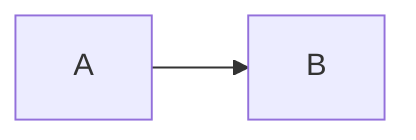

# RFC: <title>

## 1. Problem statement

### Background

<Why this work is needed now. Enough context for a reader new to the problem.>

### Goals

-

### Non-goals

-

## 2. Possible solutions

<Working area while options are explored. Each candidate: description, pros, cons, trade-offs.
Before review, move the chosen one to section 3 and the rest to section 7, then delete this section.>

## 3. Proposed solution

### Overview

### Components and contracts

<Systems involved, interfaces, schemas, API shapes. Link plan §5 and implementation plans where relevant.>

### Data flow

## 4. Compatibility and versioning

<Temporal Workflow versioning / patching, database migrations, gateway API and CRD compatibility,
configuration toggles and their defaults. Write "N/A - <reason>" if nothing applies.>

## 5. Why this approach?

## 6. Risks and failure modes

| Risk / failure | Impact | Mitigation | Rethink trigger (§7.1) |
|---|---|---|---|
| | | | |

<Cover backward compatibility, performance, security (see docs/security/threat-model.md),
licensing, external dependencies, and failure/recovery behavior.>

## 7. Alternatives considered

### <Alternative>

<Summary.> **Why not:** <reason>.

## 8. Implementation plan

<Issue-sized steps. After approval each becomes a GitHub issue; link it here.>

- [ ] <step> (#N)

<Add a Mermaid sequencing diagram if there are parallel streams or dependencies.>

## 9. Acceptance tests and demo

- **Automated acceptance:**
- **Demo:** <entry point, input, visible outcome, failure/recovery case, cleanup; evidence in docs/demos/phase-N.md>

## 10. Future work

<Intentionally deferred items and why.>
